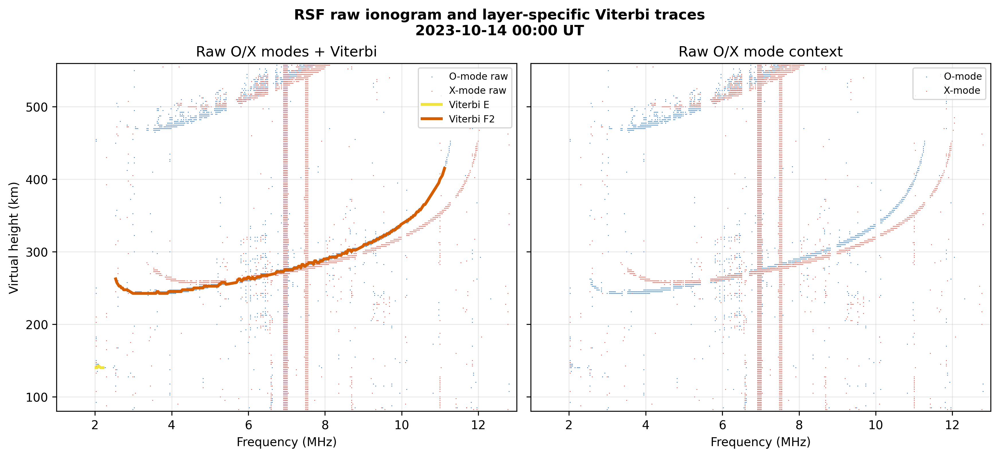

# RSF — Viterbi Autoscaling Example

<div class="hero">
  <h3>Batch RSF Scaling With Viterbi Traces</h3>
  <p>
    Parse one or more DPS4D <code>.RSF</code> files, normalize their echo
    tables, run the generic Digisonde scaler, and save scaled parameters plus
    a single-ionogram Viterbi diagnostic figure.
  </p>
</div>

This page explains `examples/digisonde/rsf_scaler.py`.

## What It Demonstrates

1. Load RSF files with `RsfExtractor`.
2. Convert each file to a pandas echo DataFrame.
3. Use `scale_dataframe(..., method="viterbi", mode="O")`.
4. Save one scaled-parameter row per file.
5. Plot raw positive-power O/X echoes with E/F2 Viterbi traces and raw O/X context.

The bundled example uses small WS833 RSF files in `examples/data/`.

## Key Code

```python
from pynasonde.digisonde.parsers.rsf import RsfExtractor
from pynasonde.digisonde.scaler import scale_dataframe_with_preset

ext = RsfExtractor(
    "examples/data/WS833_2023287000000.RSF",
    extract_time_from_name=True,
    extract_stn_from_name=True,
)
ext.extract()
raw_df = ext.to_pandas()

result, details = scale_dataframe_with_preset(
    raw_df,
    time=ext.date,
    lat_deg=33.72,
    lon_deg=-106.74,
    tuning_preset="balanced",
    e_layer_max_sza=100.0,
    mode="O",
    return_details=True,
)
```

## Run

```bash
cd /home/chakras4/Research/CodeBase/pynasonde
python examples/digisonde/rsf_scaler.py
```

To run on your own day of RSF files:

```bash
RSF_SCALER_GLOB="/path/to/day/*.RSF" RSF_SCALER_N_JOBS=8 \
python examples/digisonde/rsf_scaler.py
```

## Outputs

```text
tmp/rsf_scaled_example.csv
docs/examples/figures/rsf_scaler_viterbi.png
```

<figure markdown>

<figcaption>
Left: raw positive-power O/X RSF echoes with layer-specific Viterbi E/F2
traces. Right: raw positive-power O/X mode echo context from the same sounding.
</figcaption>
</figure>

## Related Files

- `examples/digisonde/rsf_scaler.py`
- `pynasonde/digisonde/scaler/core.py`
- `pynasonde/digisonde/scaler/viterbi.py`
- `pynasonde/digisonde/scaler/schema.py`
