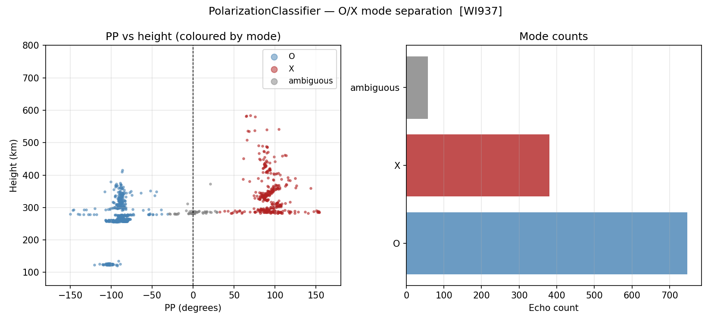

# O/X Mode Separation — PolarizationClassifier

<div class="hero">
  <h3>Label VIPIR echoes as O-mode, X-mode or ambiguous</h3>
  <p>
    Uses the PP (polarization chirality) angle of each filtered echo,
    with a configurable sign convention per hemisphere.
  </p>
</div>

This page explains `examples/vipir/analysis/polarization_example.py`.

Data used: WI937 RIQ file `WI937_2022233235902.RIQ` (loaded through `_load_data.load_echoes`).

!!! note "Install"
    `PolarizationClassifier` needs only the core dependencies: `pip install pynasonde`.
    Reading RIQ files needs `pip install "pynasonde[vipir]"`.

## Pipeline

1. Load and filter echoes into a DataFrame.
2. Fit `PolarizationClassifier(o_mode_sign=-1, pp_ambiguous_threshold_deg=30.0)`.
3. Print `result.summary()` and the first rows of `result.to_dataframe()`.
4. Plot PP vs height coloured by mode, plus a bar chart of mode counts.

## Core API

```python
from pynasonde.vipir.analysis import PolarizationClassifier

clf = PolarizationClassifier(
    o_mode_sign=-1,              # northern hemisphere: O-mode has negative PP
    pp_ambiguous_threshold_deg=30.0,
)
result = clf.fit(df)             # df: filtered echo DataFrame
labelled = result.annotated_df   # adds a "mode" column: O / X / ambiguous / unknown
```

## Output



## Run

```bash
python examples/vipir/analysis/polarization_example.py
```

## See Also

- [Polarization API](../../dev/vipir/analysis/polarization.md)
- [Ionogram Scaler example](scaler.md) — consumes the labelled DataFrame
