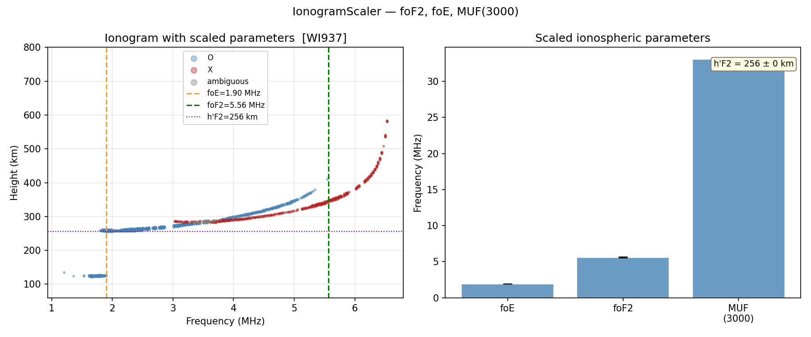

# Automatic Scaling — IonogramScaler

<div class="hero">
  <h3>foE, foF2, h′F2, MUF(3000) and M(3000)F2 with bootstrap uncertainties</h3>
  <p>
    Scales layer parameters from an O/X-labelled echo DataFrame.
  </p>
</div>

This page explains `examples/vipir/analysis/scaler_example.py`.

Data used: WI937 RIQ file `WI937_2022233235902.RIQ`.

!!! note "Install"
    `IonogramScaler` needs only the core dependencies: `pip install pynasonde`.
    Reading RIQ files needs `pip install "pynasonde[vipir]"`.

## Pipeline

1. Load and filter echoes.
2. Label O/X modes with [`PolarizationClassifier`](polarization.md).
3. Fit `IonogramScaler` on the labelled DataFrame.
4. Print the scaled parameters, their DataFrame and the quality flags.
5. Plot the ionogram with foE/foF2/h′F2 overlaid.

## Core API

```python
from pynasonde.vipir.analysis import IonogramScaler, PolarizationClassifier

ann = PolarizationClassifier(o_mode_sign=-1).fit(df).annotated_df
params = IonogramScaler(
    e_layer_height_range_km=(90, 160),
    f2_layer_height_range_km=(160, 800),
    n_bootstrap=300,
    min_echoes_for_layer=4,
).fit(ann)

print(params.summary())
print(params.to_dataframe())
```

## Output



## Run

```bash
python examples/vipir/analysis/scaler_example.py
```

## See Also

- [Scaler API](../../dev/vipir/analysis/scaler.md)
- [Polarization example](polarization.md)
